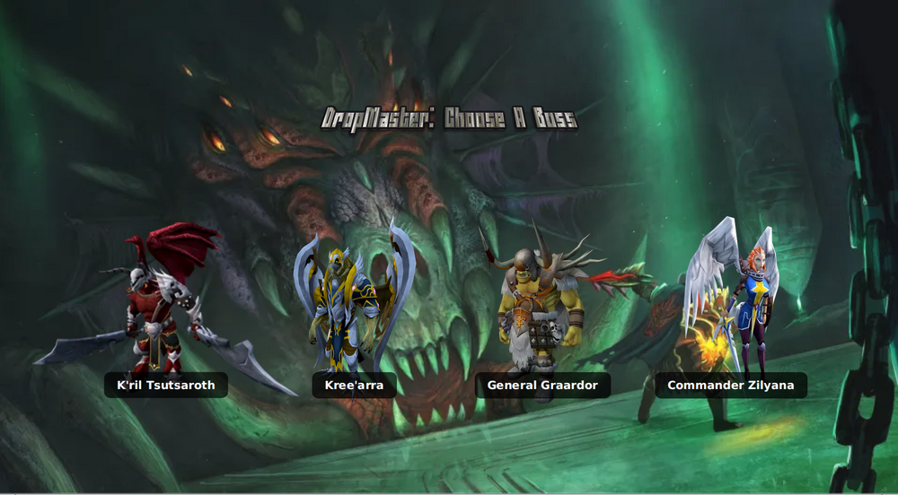
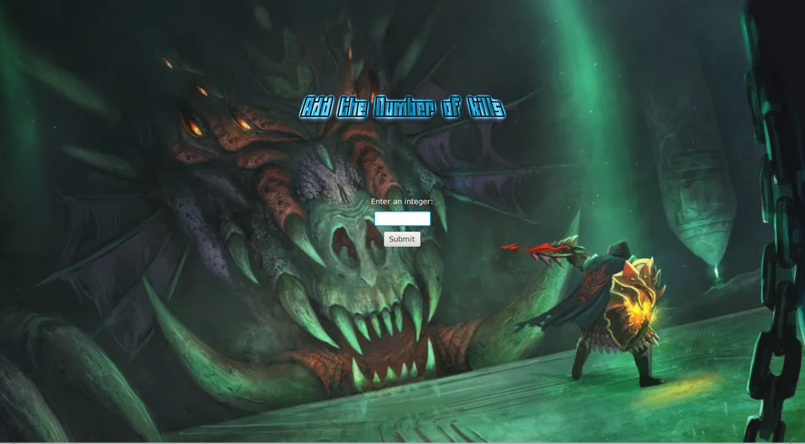
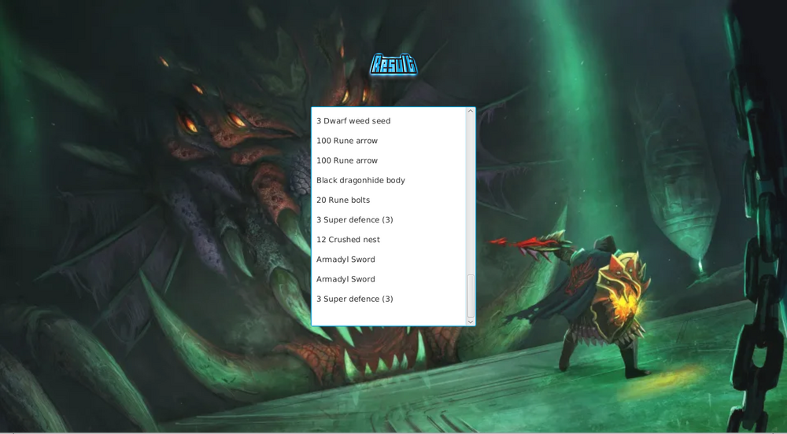
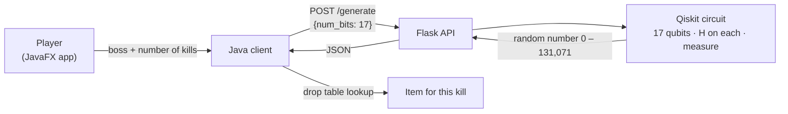

<div align="center">

# 🎲 DropMaster: a Quantum Loot Simulator

**Rare game items can take thousands of boss kills to drop. DropMaster simulates those kills with truly random numbers from a quantum circuit, so players can see how lucky (or unlucky) a grind could get before they start it.**

[](https://github.com/DanEhab/dropmaster-quantum-rng/actions/workflows/ci.yml)




</div>

---

## The idea

In RuneScape, some items are so rare that players kill the same boss hundreds or thousands of times to get them. For example, Kree'arra has about 24 possible drops, and an Armadyl helmet comes on average once every **384** kills. Some players finish the whole Armadyl set in about 100 kills, while others pass 12,000 and still haven't got it.

DropMaster lets a player pick one of the four God Wars Dungeon bosses, enter how many kills they plan, and see the full list of drops those kills could give. Each kill is decided by a **quantum random number** instead of a normal pseudo-random one.

| 1. Choose a boss | 2. Enter the number of kills | 3. See the drops |
|:---:|:---:|:---:|
|  |  |  |

---

## How it works



### The quantum random number generator

[`quantum-api/api.py`](quantum-api/api.py) builds a circuit with **17 qubits**, puts each one into an equal superposition with a **Hadamard gate**, and measures them all once:

```python
qc = QuantumCircuit(num_bits)
for qubit in range(num_bits):
    qc.h(qubit)          # |0⟩ → (|0⟩ + |1⟩)/√2
qc.measure_all()
result = simulator.run(transpile(qc, simulator), shots=1).result()
random_number = int(list(result.get_counts())[0], 2)
```

Each qubit collapses to 0 or 1 with equal probability, so the 17 bits form a uniformly random number between 0 and 2¹⁷ − 1 = 131,071. The circuit runs on IBM's Qiskit Aer simulator, and it could run on real IBM quantum hardware by switching the backend.

### From a random number to a drop

[`backend.java`](javafx-client/src/APIClient/backend.java) splits the 131,072 possible numbers into ranges, one per item, sized to match each item's drop rate from the RuneScape wiki. Common drops get large ranges and rare ones get small ranges. For example, the Armadyl helmet has 1/384 of the range.

Why use quantum randomness? Pseudo-random generators are deterministic: if you know the seed, you know every result. Quantum measurement is random by nature, which makes the results impossible to predict and fair for everyone.

---

## Run it

**1. Start the quantum API** (Python 3.10+):

```console
$ cd quantum-api
$ pip install -r requirements.txt
$ python api.py            # serves POST /generate on http://127.0.0.1:5000
$ python test_api.py       # optional: Response from API: {'random_numbers': [29, 27, 11]}
```

**2. Start the app** (JDK 17+ and Maven):

```console
$ cd javafx-client
$ mvn javafx:run
```

The original Eclipse project files are also included, so `javafx-client` can be imported into Eclipse directly.

## Tests

GitHub Actions runs both parts on every push:

- **Quantum API**: starts the server and requests 200 numbers, then checks that they are all in range and almost never repeat.
- **Client**: a JUnit test checks that **every one of the 131,072 possible quantum outcomes** maps to an item in all four drop tables, and that the Armadyl helmet comes out at about 1 in 384, as in the case study.

---

## Hackathon & team

Built in about a week for the **Qubit – IBM Qiskit Fall Fest 2024** hackathon at the German University in Cairo (November 2024). The challenge was to build a quantum random number generator and use it in any application. The project earned an IBM certificate of participation for completing a quantum project at the Fall Fest.

**Team "Out of Schrödinger's Box":** Daniel Ehab · Ahmed Badran · Youssif Walid · Omar Ayman

The slides from the final presentation are in [`docs/presentation.pptx`](docs/presentation.pptx).

<sub>RuneScape, its bosses and its artwork belong to Jagex. This is a non-commercial hackathon project.</sub>
